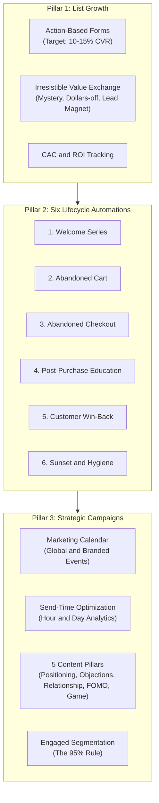
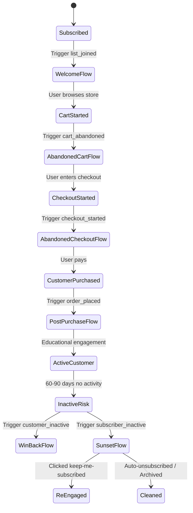
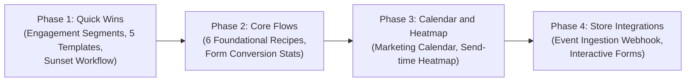

# Mailflow Improvement Plan: Modern Email Marketing Strategy

This document describes how to improve the Mailflow platform.
The improvements follow the principles from `email_marketing_statergy.txt` ("Email Marketing Strategy That Actually Works in 2026").

---

## 1. Executive Summary and Strategy Overview

The strategy document explains that modern email marketing must drive direct business revenue.
Email marketing fails when brands only send generic newsletters or basic 10% discounts.

The strategy framework has three core pillars:
1. **List Growth**: Replace basic forms with high-converting, action-based opt-in experiences (10% to 15% conversion rate).
2. **Lifecycle Automations**: Deploy six foundational automated sequences that cover every stage of the customer journey.
3. **Strategic Campaigns and Calendar**: Plan broadcast emails on a 6 to 12 month calendar. Use five specific educational content pillars. Send 95% of campaigns to an engaged segment.



---

## 2. Current System Audit and Gap Analysis

This section compares the current Mailflow codebase with the strategy requirements.

| Strategy Requirement | Current Mailflow Implementation | Status | Required Improvement |
|---|---|---|---|
| **High-Converting Opt-In Forms** | Basic static form card ([`components/forms/signup-card.tsx`](file:///D:/Projects/mailflow-app/mailflow-app/components/forms/signup-card.tsx)). Only title, text, color, button. | Partial | Add pop-up, slide-in, mystery discount, and lead magnet delivery forms. |
| **Form Conversion Analytics** | No impression tracking. No submit rate tracking. | Missing | Track form impressions and submits. Calculate conversion rate percentage. |
| **Customer Journey Automations** | Visual node builder exists ([`lib/automation-flow.ts`](file:///D:/Projects/mailflow-app/mailflow-app/lib/automation-flow.ts)). Only 2 triggers: `list_joined`, `tag_added`. | Partial | Add e-commerce event triggers (`cart_abandoned`, `checkout_started`, `order_placed`, `days_inactive`). |
| **Pre-built Journey Recipes** | Has basic recipes in [`lib/automation-templates.ts`](file:///D:/Projects/mailflow-app/mailflow-app/lib/automation-templates.ts): Welcome, Follow-up, Nurture, A/B test. | Partial | Add the 6 foundational lifecycle flows: Welcome, Cart, Checkout, Post-Purchase, Win-back, Sunset. |
| **List Sunset and Hygiene** | Manual contact deletion only. No automated inactive subscriber pruning. | Missing | Add automated sunset workflow. Unsubscribe or archive inactive contacts automatically. |
| **Marketing Calendar View** | Tabular campaign list only (Draft, Scheduled, Sending, Sent). | Missing | Add visual calendar view showing scheduled campaigns, global events, and product launches. |
| **Send-Time Optimization** | Campaigns send immediately or at fixed future date ([`worker/processors.ts`](file:///D:/Projects/mailflow-app/mailflow-app/worker/processors.ts)). No time heatmap. | Missing | Add engagement heatmap (opens and clicks grouped by day of week and hour of day). |
| **Educational Content Pillars** | Gallery has generic categories ([`lib/template-gallery.ts`](file:///D:/Projects/mailflow-app/mailflow-app/lib/template-gallery.ts)): Welcome, Newsletter, Promotion, Announcement. | Partial | Add templates for the 5 strategic pillars: Positioning, Objections, Relationship, FOMO, Gamification. |
| **The 95% Engaged Segment Rule** | Campaigns send to all active contacts in chosen lists ([`lib/campaigns.ts`](file:///D:/Projects/mailflow-app/mailflow-app/lib/campaigns.ts#L56)). | High Risk | Add dynamic engagement filter (30/60/90 days active) to campaign sending to protect sender reputation. |

---

## 3. Detailed Improvement Specifications

### 3.1 Pillar 1: High-Converting List Growth

The video notes that standard 10% discount pop-ups produce poor conversion (5% to 9%).
Modern brands achieve 10% to 15% conversion through compelling presentation, gamification, and clear value exchange.

#### A. Interactive Form Styles and Presentation Modes
Extend the form configuration in [`lib/forms.ts`](file:///D:/Projects/mailflow-app/mailflow-app/lib/forms.ts) and [`components/forms/signup-card.tsx`](file:///D:/Projects/mailflow-app/mailflow-app/components/forms/signup-card.tsx):
- **Form Display Modes**:
  - `inline`: Embedded card on page.
  - `popup`: Modal dialog triggered after delay (e.g. 5 seconds) or scroll percentage (e.g. 50%).
  - `slide_in`: Subtle corner notification widget.
- **Incentive Delivery Types**:
  - `lead_magnet`: Delivers an instant resource link (ebook, checklist, video) in the success state.
  - `discount_code`: Reveals a coupon code immediately upon subscription confirmation.
  - `mystery_discount`: Interactive reveal element ("Pick your code" or "Click to reveal your offer").

#### B. Form Analytics and Conversion Tracking
- Record two metric counters in Redis / Appwrite for every public form:
  - `impressions`: Number of times the form is viewed.
  - `submissions`: Number of confirmed or pending sign-ups.
- Calculate:
  $$\text{Conversion Rate} = \left( \frac{\text{submissions}}{\text{impressions}} \right) \times 100$$
- Show conversion rate badge on the Lists and Developer Forms screens. Alert the user if conversion drops below 8%.

---

### 3.2 Pillar 2: The Six Foundational Lifecycle Automations

Mailflow must support the six customer lifecycle stages defined in the strategy.



#### 1. Welcome Automation (Subscriber to First Purchase)
- **Goal**: Convert a new subscriber into a paying customer.
- **Sequence**:
  - Step 1: Immediate delivery of promised offer / lead magnet + founder welcome.
  - Step 2 (Wait 2 days): Brand positioning and customer problem definition.
  - Step 3 (Wait 2 days): Objection handling, social proof, and customer reviews.
  - Step 4 (Wait 3 days): Time-limited special incentive reminder.

#### 2. Abandoned Cart Automation (Add to Cart to Purchase)
- **Goal**: Recover shoppers who added products to their cart but left the website.
- **Sequence**:
  - Step 1 (Wait 1 to 2 hours): Helpful service inquiry ("Did you leave something behind?"). Show items.
  - Step 2 (Wait 24 hours): Highlight key product benefits, guarantees, and customer support contact.
  - Step 3 (Wait 24 hours): Soft urgency or small incentive if cart remains open.

#### 3. Abandoned Checkout Automation (Start Checkout to Purchase)
- **Goal**: Recover shoppers who entered shipping or contact details but did not complete payment.
- **Sequence**:
  - Step 1 (Wait 30 minutes): Direct checkout link with items saved.
  - Step 2 (Wait 12 hours): Overcome payment or shipping objections (returns policy, secure checkout).
  - Step 3 (Wait 24 hours): Final expiration notice for reserved inventory.

#### 4. Post-Purchase Automation (Buyer to Loyal Fan)
- **Goal**: Eliminate buyer remorse, improve product adoption, and build brand loyalty.
- **Content Style**: Plain-text, customer-service focused, educational.
- **Sequence**:
  - Step 1 (Immediate upon order): Order confirmation + founder thank you note.
  - Step 2 (Wait 3 days / after delivery): "How to use your product for best results" educational guide.
  - Step 3 (Wait 7 days): Product care instructions and best practice tips.
  - Step 4 (Wait 14 days): Customer satisfaction check-in and review request.

#### 5. Win-Back Automation (Lapsed Customer to Active Buyer)
- **Goal**: Re-activate previous buyers who have not purchased in 60 to 90 days.
- **Sequence**:
  - Step 1: "We miss you" note highlighting new product arrivals and collection updates.
  - Step 2 (Wait 5 days): Exclusive returning customer reward code.
  - Step 3 (Wait 5 days): Final reminder of VIP reward.

#### 6. Sunset Automation (Churn Risk to Re-engaged or Exited)
- **Goal**: Clean dead weight from the list to protect inbox deliverability.
- **Sequence**:
  - Step 1: Honest, text-based check-in ("Should we part ways?"). Single button: "Keep me subscribed".
  - Step 2 (Wait 7 days): Final notification ("You will be removed from our list tomorrow").
  - Step 3: Automatic unsubscription / archiving of the contact.

---

### 3.3 Pillar 3: Strategic Campaigns, Content Pillars, and Marketing Calendar

#### A. Interactive Marketing Calendar (6 to 12 Months)
Replace the simple campaign list with a comprehensive Marketing Calendar view:
- **Global Event Layer**: Pre-populate key retail dates (Black Friday, Cyber Monday, Valentine's Day, Mother's Day, End-of-Year sales).
- **Branded Event Layer**: Add custom markers for Product Launches, Anniversary Sales, and Collection Drops.
- **Launch Hype Timelines**: Visual 3-phase timeline for branded launches:
  1. *Hype Phase* (2 weeks before): Teasers, waitlist sign-ups, VIP early access list.
  2. *Launch Phase* (Launch day): Early bird broadcast + public announcement.
  3. *Post-Launch Phase* (1 week after): Social proof, user reviews, last-chance reminder.
- **Gap Highlighting**: Highlight calendar weeks that lack scheduled value emails to maintain a regular 1 to 3 email/week rhythm.

#### B. Send-Time Optimization Heatmap
- Analyze open and click events from [`lib/reports.ts`](file:///D:/Projects/mailflow-app/mailflow-app/lib/reports.ts).
- Group event timestamps by:
  - Day of week (Monday through Sunday).
  - Hour of day (00:00 to 23:00 in account timezone).
- Render an interactive 7x24 activity heatmap on the Campaigns page.
- Recommend optimal send windows (e.g. "Highest open rate occurs Tuesday at 08:00 AM").

#### C. The Five Strategic Content Pillar Templates
Add five ready-to-use email templates to [`lib/template-gallery.ts`](file:///D:/Projects/mailflow-app/mailflow-app/lib/template-gallery.ts):
1. **Positioning Template ("Us vs Them / Myth vs Fact")**:
   - Compares common industry misconceptions against the brand's verified method.
   - Positions the sender as an authority without hard selling.
2. **Objection Handling Template ("Pain Point to Solution")**:
   - Addresses the top 3 customer doubts. Includes testimonials, before-and-after proof, and FAQ section.
3. **Relationship Template ("Founder Note")**:
   - Minimalist, text-only email styling.
   - Tells an authentic behind-the-scenes story from the founder or team.
4. **FOMO Template ("Trending Now / Selling Fast")**:
   - Highlights popular items, low-stock alerts, or restocked favorites. Creates healthy urgency.
5. **Gamification Template ("Interactive Quiz / Click to Reveal")**:
   - Interactive visual buttons ("Question 1: Which option fits you?"). Links trigger tag-based automation paths.

---

### 3.4 Pillar 4: Deliverability and Smart Segmentation (The 95% Rule)

Sending campaigns to an unsegmented list causes high bounce rates, low engagement, spam complaints, and domain throttling.
The strategy mandates that **95% of broadcast campaigns must send to engaged contacts only**.

#### A. Contact Engagement Scoring and Tiers
Add dynamic engagement classification in [`lib/contacts.ts`](file:///D:/Projects/mailflow-app/mailflow-app/lib/contacts.ts):
- **Engaged 30 Days**: Opened or clicked an email in the last 30 days, or subscribed in the last 30 days.
- **Engaged 60 Days**: Opened or clicked within 31 to 60 days.
- **Engaged 90 Days**: Opened or clicked within 61 to 90 days (Recommended broadcast baseline).
- **Dormant / Churn Risk**: No opens or clicks for 90+ days.
- **Unengaged / Inactive**: No activity for 120+ days. Automatically entered into the Sunset Flow.

#### B. Campaign Audience Selector with Safety Defaults
Update campaign preparation in [`lib/campaigns.ts`](file:///D:/Projects/mailflow-app/mailflow-app/lib/campaigns.ts) and the Campaign Review screen:
- Add an `Audience Engagement Filter` dropdown:
  - `engaged_90` (Default, Recommended): Active contacts with activity in past 90 days.
  - `engaged_30`: Highest engagement for time-sensitive promotions.
  - `all_active` (Warning required): Shows warning: *"Sending to unengaged contacts can degrade domain reputation and trigger spam filtering."*

---

## 4. Technical Architecture and Database Changes

All database modifications are additive, maintaining strict backward compatibility.

### 4.1 Schema Additions in `scripts/setup-tables.ts`

```typescript
// Additions to 'lists' table
{ key: "formStyle", type: "varchar", size: 20, default: "inline" }, // inline | popup | slide_in
{ key: "incentiveType", type: "varchar", size: 20, default: "standard" }, // standard | lead_magnet | discount_code | mystery
{ key: "incentiveData", type: "text" }, // JSON string: { code, resourceUrl, discountText }
{ key: "formImpressions", type: "int", default: 0 },
{ key: "formSubmits", type: "int", default: 0 },

// Additions to 'contacts' table
{ key: "lastEngagedAt", type: "datetime" }, // Updated on message open or click
{ key: "engagementScore", type: "int", default: 100 },
{ key: "customerStatus", type: "varchar", size: 20, default: "subscriber" }, // subscriber | customer | churn_risk

// Additions to 'campaigns' table
{ key: "audienceFilter", type: "varchar", size: 30, default: "engaged_90" }, // engaged_30 | engaged_60 | engaged_90 | all_active
{ key: "calendarCategory", type: "varchar", size: 30 }, // global_event | branded_launch | regular_value
```

### 4.2 Webhook API for E-commerce Lifecycle Events
Create a dedicated route `POST /api/v1/events` for receiving store events from Shopify, WooCommerce, Stripe, or custom storefronts:
- Accepts:
  ```json
  {
    "event": "cart.abandoned" | "checkout.started" | "order.placed",
    "email": "customer@example.com",
    "name": "Jane Doe",
    "properties": {
      "cartTotal": 89.00,
      "cartItems": [{ "name": "Organic Coffee Beans", "price": 18.00 }],
      "checkoutUrl": "https://store.example.com/checkouts/xyz"
    }
  }
  ```
- Authenticates using existing secret API keys (`sk_live_...`).
- Updates contact tags and triggers corresponding automations via [`lib/automation-trigger.ts`](file:///D:/Projects/mailflow-app/mailflow-app/lib/automation-trigger.ts).

---

## 5. Phased Implementation Roadmap

The implementation is broken into four sequential phases.



### Phase 1: High Priority (Deliverability and Content Foundations)
- [ ] Add `lastEngagedAt` tracking to [`worker/ses-events.ts`](file:///D:/Projects/mailflow-app/mailflow-app/worker/ses-events.ts) and tracking redirect routes ([`app/t/c/[token]/route.ts`](file:///D:/Projects/mailflow-app/mailflow-app/app/t/c/[token]/route.ts), [`app/t/o/[token]/route.ts`](file:///D:/Projects/mailflow-app/mailflow-app/app/t/o/[token]/route.ts)).
- [ ] Add "Engaged Audience" filtering (90-day active default) to [`lib/campaigns.ts`](file:///D:/Projects/mailflow-app/mailflow-app/lib/campaigns.ts).
- [ ] Implement the 5 Strategic Content Pillar templates in [`lib/template-gallery.ts`](file:///D:/Projects/mailflow-app/mailflow-app/lib/template-gallery.ts).
- [ ] Build the Sunset and List Hygiene recipe in [`lib/automation-templates.ts`](file:///D:/Projects/mailflow-app/mailflow-app/lib/automation-templates.ts).

### Phase 2: Medium Priority (Lifecycle Flows and Form Conversion)
- [ ] Add the remaining lifecycle recipes to [`lib/automation-templates.ts`](file:///D:/Projects/mailflow-app/mailflow-app/lib/automation-templates.ts):
  - Abandoned Cart Flow.
  - Abandoned Checkout Flow.
  - Post-Purchase Education Flow.
  - Win-Back Flow.
- [ ] Add form impression and submit tracking in [`app/s/[listId]/page.tsx`](file:///D:/Projects/mailflow-app/mailflow-app/app/s/[listId]/page.tsx) and [`app/api/v1/subscribe/route.ts`](file:///D:/Projects/mailflow-app/mailflow-app/app/api/v1/subscribe/route.ts).
- [ ] Display Form Conversion Rate percentage in the Forms UI.

### Phase 3: Advanced Optimization (Calendar and Heatmap)
- [ ] Add the interactive Marketing Calendar view at `app/(dashboard)/campaigns/calendar/`.
- [ ] Implement the 7x24 Send-Time Heatmap component in [`app/(dashboard)/campaigns/`](file:///D:/Projects/mailflow-app/mailflow-app/app/(dashboard)/campaigns/).
- [ ] Add launch timeline hype-period indicators to the calendar.

### Phase 4: E-Commerce and Interactive Opt-ins
- [ ] Implement `POST /api/v1/events` endpoint for e-commerce event ingestion.
- [ ] Add pop-up and slide-in display modes to embedded subscribe scripts ([`lib/embed.ts`](file:///D:/Projects/mailflow-app/mailflow-app/lib/embed.ts)).
- [ ] Add mystery discount / coupon code reveal logic to subscribe completion screens.

---

## 6. Success Metrics and Acceptance Criteria

Following implementation, system performance must satisfy these quantitative targets:

| Metric | Target | Verification Method |
|---|---|---|
| **Subscribe Form Submit Rate** | $\ge 10\%$ to $15\%$ | Tracked by form impression and submission counters. |
| **Email Deliverability Rate** | $\ge 98.5\%$ | Verified via SES delivery events and bounce/complaint monitoring. |
| **Spam Complaint Rate** | $< 0.05\%$ | Guarded by the 95% Engaged Segment default and Sunset automation. |
| **Average Open Rate** | $\ge 35\%$ to $45\%$ | Measured across engaged broadcast campaigns and welcome sequences. |
| **Automated Revenue Contribution** | $\ge 40\%$ of email sales | Monitored through lifecycle automation tracking tags and conversion links. |

---

## 7. Guidelines for Agents

- Write all future code, comments, and documentation strictly in ASD-STE100 (Simplified Technical English).
- Do not modify or disclose `.env` secrets.
- Do not execute destructive database commands (never run `npm run db:reset`).
- Run `npm run lint`, `npx tsc --noEmit`, and `npm test` after each phase of changes.
- Ensure all new public routes maintain complete backward compatibility.
